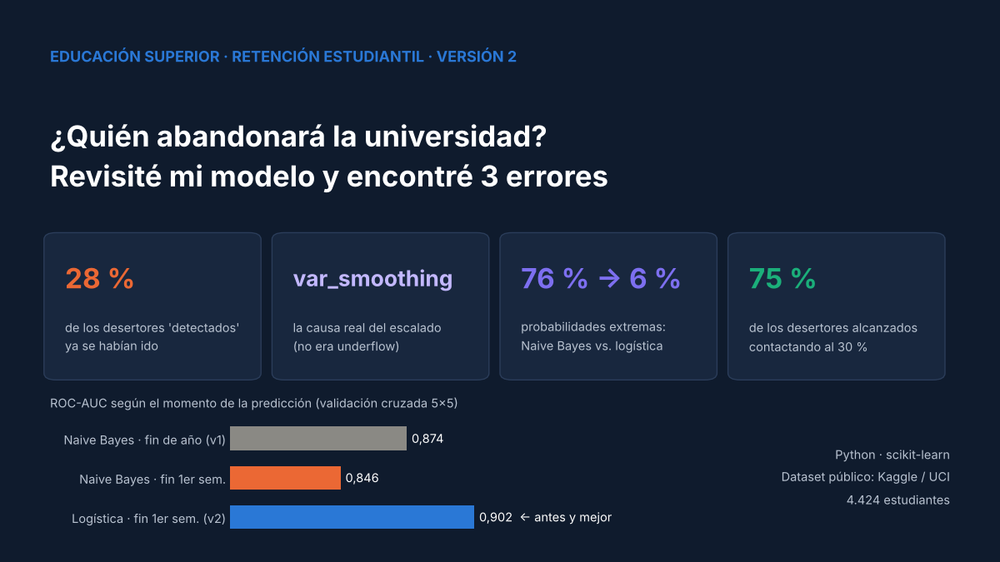
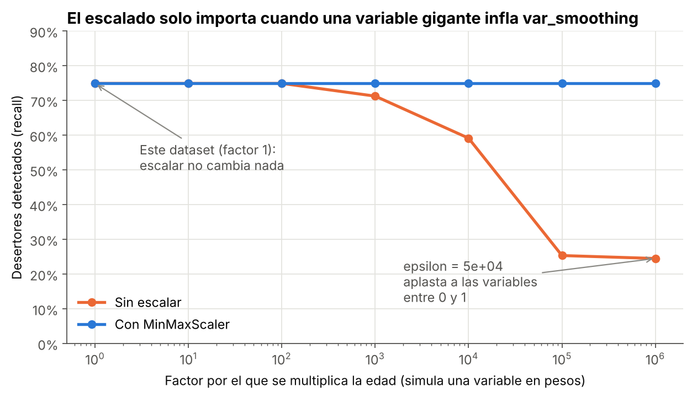
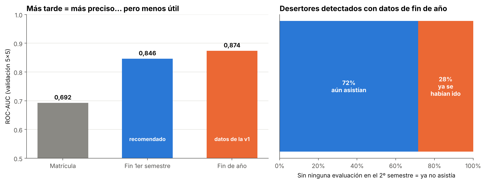
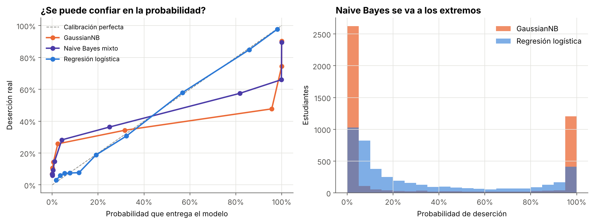
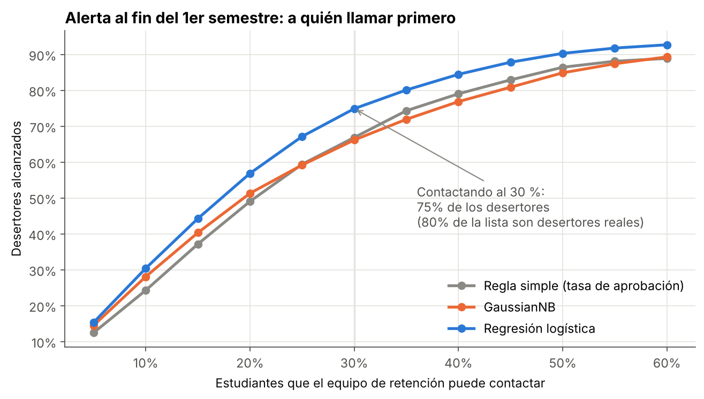

# 🎓 ¿Quién abandonará la universidad? Revisité mi modelo y encontré 3 errores

> **Versión 2 de mi proyecto de deserción estudiantil con Naive Bayes.** Volví a mi análisis original y encontré tres problemas: la explicación del escalado era incorrecta, el modelo usaba datos de un momento en que muchos desertores ya se habían ido y se rompían supuestos de Naive Bayes. Corregirlos llevó a una alerta temprana que llega **un semestre antes** y funciona **mejor**.




---

## 🎯 Problema

Una institución de educación superior pierde a **1 de cada 3 estudiantes** (32,1 %) antes de titularse. El equipo de retención tiene capacidad limitada y necesita saber **a quién** apoyar y **cuándo** puede saberlo, mientras el estudiante todavía está.

**Uso responsable:** el modelo prioriza **apoyo** (tutorías, orientación, ayuda financiera), nunca sanciones, cobros ni rechazos de matrícula.

## 🔁 Qué cambió respecto de la versión 1

| | Versión 1 | Versión 2 |
|---|---|---|
| Modelo | GaussianNB | **Regresión logística** (Naive Bayes mixto como alternativa) |
| Momento de la predicción | Fin de año (2º semestre) | **Fin del 1er semestre** |
| Validación | 1 split | **25 particiones** (validación cruzada 5×5) |
| Exactitud | 84,8 % | **86,0 %** |
| ROC-AUC | No reportado | **0,902** |
| Explicación del escalado | *Underflow* (incorrecto) | **`var_smoothing`** (demostrado) |
| Calibración de probabilidades | No evaluada | **Brier 0,104** (GaussianNB: 0,182) |

La versión 1 se conserva intacta en [`version_original/`](version_original/). En sus conclusiones decía "84,8 % de **precisión**", pero ese número era la **exactitud**; la precisión era 77,1 %.

## ❌ Error 1: el escalado no era el problema

La v1 decía que, en el ejemplo bancario del curso, escalar era indispensable porque `Balance` (hasta 250.000) causaba *underflow* numérico. **No es así.** GaussianNB estima media y varianza por variable, así que multiplicar una variable por 1.000 no cambia las probabilidades relativas.

Lo único que rompe esa inmunidad es **`var_smoothing`**: scikit-learn suma a todas las varianzas `1e-9 × la varianza más grande`. Si una variable es gigante, ese valor aplasta a las variables pequeñas (como las tasas de aprobación, entre 0 y 1).



Simulando una variable "en pesos", el recall cae de 75 % a 25 % sin escalar; con `MinMaxScaler` se mantiene. En este dataset la varianza máxima es ~122 y el `epsilon` es ~1e-7: escalar no cambia ninguna predicción (100 % idénticas).

## ❌ Error 2: el momento de la predicción

La v1 usaba las notas del **2º semestre**. Pero el **21 % de los desertores** no rindió ninguna evaluación en ese semestre (vs. 3 % del resto): cuando el modelo tenía sus datos, ya se habían ido.



Con datos de fin de año el modelo se ve mejor, pero **el 28 % de los desertores que "detecta" ya no asistía**. El fin del **1er semestre** es el mejor equilibrio: casi el mismo poder predictivo y un semestre completo para actuar.

## ❌ Error 3: los supuestos de Naive Bayes

Naive Bayes asume que cada variable tiene la distribución correcta y que las variables son independientes. Aquí se rompen ambos supuestos:

- **Códigos tratados como números.** `Course` vale de 1 a 17, pero el curso 12 no es "el doble" del 6. Construí un **Naive Bayes mixto** (`CategoricalNB` + `GaussianNB`), que mejora el ROC-AUC en la matrícula de 0,692 a 0,736.
- **Variables correlacionadas.** Las tasas de aprobación del 1er y 2º semestre tienen una correlación de 0,87. Naive Bayes cuenta dos veces la misma información y **3 de cada 4 probabilidades quedan bajo 1 % o sobre 99 %**.



| ROC-AUC (validación 5×5) | Matrícula | Fin 1er semestre | Fin de año |
|---|---|---|---|
| GaussianNB | 0,692 | 0,846 | 0,874 |
| Naive Bayes mixto | 0,736 | 0,852 | 0,874 |
| **Regresión logística** | **0,767** | **0,902** | **0,920** |

La regresión logística gana en los tres momentos y entrega probabilidades confiables.

## 🎲 Validación honesta

El mismo modelo de la v1, evaluado en 25 particiones, da una exactitud media de **83,3 %** (rango de 81,1 % a 85,6 %). El 84,8 % original fue un split afortunado: superó al 92 % de las particiones.

## 🚨 Alerta temprana: a quién contactar primero



| Contactando al… | Regla simple (tasa de aprobación) | GaussianNB | **Regresión logística** |
|---|---|---|---|
| 20 % de los estudiantes | 49 % de los desertores | 51 % | **57 %** (91 % de la lista son desertores) |
| 30 % de los estudiantes | 67 % | 66 % | **75 %** (80 % de la lista son desertores) |

Al terminar el 1er semestre, contactar al 30 % de los estudiantes permite alcanzar a **3 de cada 4 futuros desertores**.

## 🗂️ Estructura del repositorio

```
prediccion-desercion-estudiantil/
├── data/                  # dataset.csv (CC BY 4.0)
├── images/                # Gráficos del análisis
├── notebooks/
│   └── desercion_estudiantil_naive_bayes_v2.ipynb
├── reports/               # Tablas de resultados (CSV)
├── version_original/      # Script y gráfico de la versión 1, sin cambios
├── requirements.txt
├── LICENSE
└── README.md
```

## ▶️ Cómo reproducirlo

```bash
git clone https://github.com/Cristobal-111/prediccion-desercion-estudiantil.git
cd prediccion-desercion-estudiantil
pip install -r requirements.txt
jupyter notebook notebooks/desercion_estudiantil_naive_bayes_v2.ipynb
```

La ejecución completa toma menos de 1 minuto.

## ⚠️ Limitaciones

- Datos de **una sola institución** portuguesa.
- El dataset no trae la fecha exacta del abandono; uso "cero evaluaciones en el semestre" como señal de que el estudiante ya no asistía.
- Supuesto: deuda y aranceles al día se conocen durante el año, no al matricular.
- El modelo identifica **riesgo, no causas**: las intervenciones deberían evaluarse con un piloto.

## 📚 Fuente de datos

[Predict students' dropout and academic success — Kaggle](https://www.kaggle.com/datasets/thedevastator/higher-education-predictors-of-student-retention) · Realinho, V., Machado, J., Baptista, L. y Martins, M. V. (2021). [DOI 10.5281/zenodo.5777340](https://doi.org/10.5281/zenodo.5777340)

Proyecto basado en la metodología del **Google Advanced Data Analytics Professional Certificate** (Coursera).

## 👤 Autor

**Cristóbal Rojas Troncoso** · Ingeniero Civil Industrial | Inteligencia de negocios y análisis de datos
[LinkedIn](https://www.linkedin.com/in/cristobal-rojas-troncoso/) · [GitHub](https://github.com/Cristobal-111)
